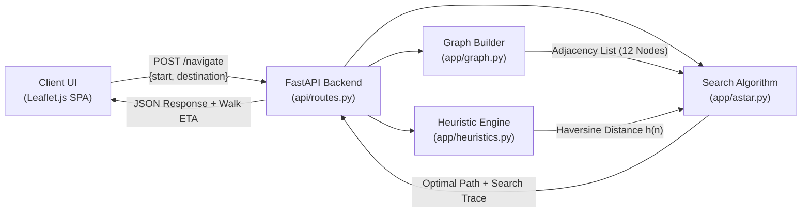

# KL Campus Navigator

> Walkable pedestrian route planner for university campuses that computes optimal paths using A* search with GPS-calibrated Haversine heuristics, rendered on an interactive map.

---

## 📸 Demo Preview

```
+----------------------------------------------------------------------------------------------------+
|  [🏫 KL Campus Navigator]          |  Map View (Leaflet.js + OpenStreetMap)                        |
|                                    |                                                                |
|  From: [ Main Gate           v ]   |      (Hostel)                                                  |
|  To:   [ Cafeteria           v ]   |         *                                                      |
|                                    |          \                                                     |
|  [ Find Route (A*) ]               |           \   (Admin)       (Auditorium)                       |
|  [ Compare Algorithms ]            |            \     * ------------ *                              |
|  [ Find Nearest Cafeteria ]        |             \   / \            /                               |
|                                    |    (Gate)    \ /   * (Labs)   /                                |
|  --------------------------------  |      * -------*------------- * (Cafeteria) [DEST]              |
|  Optimal Route Found               |     [START]   (Library)                                        |
|  Route: Main Gate -> Cafeteria     |                                                                |
|  Distance: 197.1 m | ETA: ~2.5 min |  [Polyline drawn in blue: 197.1 m, 2 nodes expanded]           |
|  Nodes Expanded: 2 (A*) vs 11 (Dij)|                                                                |
+----------------------------------------------------------------------------------------------------+
```

<p align="center">
  
</p>

---

## 1. The Problem

Commercial navigation services like Google Maps are designed primarily for vehicular roads. On a sprawling 100+ acre university campus, they fail to map pedestrian pathways between academic blocks, student amenities, and research labs. Freshers, faculty, and campus visitors frequently lose 10–15 minutes walking in the wrong direction between back-to-back classes because available maps lack landmark-level pedestrian connectivity and walking ETAs.

---

## 2. The Solution & Key Features

KL Campus Navigator models the physical campus as a walkable spatial graph with real GPS coordinates and provides:

- **GPS-Accurate A\* Pathfinding:** Computes shortest pedestrian routes using great-circle Haversine distance as an admissible heuristic ($h(n) \le h^*(n)$).
- **Algorithm Benchmark Engine:** Runs A\*, Dijkstra, BFS, and DFS on the exact same origin-destination pair to empirically compare search space and path optimality.
- **Interactive Visual Client:** A single-page Leaflet.js interface with animated route drawing, landmark popups, and instant walk-time estimates.
- **Amenity Search:** One-click queries for the nearest cafeteria, library, or medical clinic from any location.
- **RESTful API Backend:** Decoupled FastAPI architecture with JSON endpoints and automated OpenAPI docs (`/docs`).

---

## 3. Architecture & Design Decisions

### System Flow



### Key Technical Decisions

| Decision | Alternative Considered | Why We Chose This |
|---|---|---|
| **A\* with Haversine Heuristic** | Dijkstra / Greedy Best-First | Dijkstra explores uniformly in circles ($11$ nodes on our test case); A\* targets the destination ($3$ nodes expanded, **73% fewer explorations**) while mathematically guaranteeing the shortest path. |
| **FastAPI** | Flask / Django | Built-in Pydantic data validation, async support, auto-generated interactive OpenAPI/Swagger docs, and zero-overhead performance. |
| **Leaflet.js + OSM Tiles** | Google Maps JavaScript API | 100% open-source, requires no paid API keys or billing setup, and lightweight ($<40$ KB JS bundle). |
| **Pure Python Algorithmic Core** | NetworkX dependency | Writing A\*, Dijkstra, BFS, and DFS from scratch allows step-by-step search tracing ($f, g, h$ scores) without external black-box library overhead. |

---

## 4. Tech Stack

| Layer | Technologies |
|---|---|
| **Backend API** | Python 3.12, FastAPI 0.115, Uvicorn 0.32, Pydantic v2 |
| **Algorithms** | A\* Search, Dijkstra's Algorithm, Breadth-First Search, Depth-First Search |
| **Spatial Math** | Haversine Great-Circle Trigonometry |
| **Frontend** | Vanilla JavaScript (ES6+), Leaflet.js 1.9, OpenStreetMap Tiles, HTML5/CSS3 |
| **Testing** | pytest 8.0, HTTPX (TestClient integration tests) |
| **DevOps** | Docker, Docker Compose, Windows Batch automation |

---

## 5. Setup & Run Instructions

### Prerequisites
- **Python:** Version 3.10, 3.11, or 3.12 (`python --version`)
- **Git:** Version 2.25+ (`git --version`)
- Optional: Docker 20+

### Option A: Local Run (Fastest)

```bash
# 1. Clone the repository
git clone https://github.com/anikhapadala2024-cloud/CampusNavigationSystem.git
cd CampusNavigationSystem

# 2. Install dependencies
pip install -r requirements.txt

# 3. Start the application
python main.py
```

*On Windows, you can alternatively double-click `start.bat`.*

**Expected Output:**
```text
INFO:     Started server process [12844]
INFO:     Waiting for application startup.
INFO:     Application startup complete.
INFO:     Uvicorn running on http://0.0.0.0:8000 (Press CTRL+C to quit)
```

**Access the Application:**
- **Web App:** Open `http://localhost:8000` (auto-redirects to the interactive map)
- **API Docs:** Open `http://localhost:8000/docs`

---

### Option B: Docker Container

```bash
# Build and run with healthcheck
docker compose up --build
```

---

## 6. Usage & Walkthrough

### Example 1: Route Finding (`POST /navigate`)

**Request:**
```bash
curl -X POST "http://localhost:8000/navigate" \
     -H "Content-Type: application/json" \
     -d '{"start": "Main Gate", "destination": "Cafeteria"}'
```

**Actual Response:**
```json
{
  "algorithm": "A*",
  "path": [
    "Main Gate",
    "Cafeteria"
  ],
  "distance_metres": 197.1,
  "nodes_expanded": 2,
  "estimated_walk_time_minutes": 2.46,
  "trace": [
    "Expanded: Main Gate | g=0.0 | f=197.1",
    "Expanded: Cafeteria | g=197.1 | f=197.1"
  ]
}
```

---

### Example 2: Algorithm Comparison (`POST /compare`)

**Query:** Route from **Main Gate** to **Auditorium**

| Metric | A\* Search | Dijkstra | Breadth-First (BFS) | Depth-First (DFS) |
|---|---|---|---|---|
| **Path** | Gate → Auditorium | Gate → Auditorium | Gate → Auditorium | Gate → Workshop → Medical → Hostel → Sports → Auditorium |
| **Total Distance** | **300.4 m** | **300.4 m** | 1 hop | 1,348.7 m |
| **Nodes Expanded** | **3** | **11** | 8 | 6 |
| **Optimal Distance?** | ✅ Yes | ✅ Yes | ⚠️ Hop-only | ❌ No |

*Observation: A\* achieves identical optimal distance to Dijkstra while evaluating 73% fewer nodes.*

---

## 7. Automated Test Suite

The project includes unit and property tests covering path optimality, heuristic admissibility, and graph integrity.

### Run Tests:
```bash
python -m pytest tests -v
```

### Coverage Summary:
- `tests/test_astar.py` (5 tests): Validates shortest path correctness, unreachable nodes, self-destination edge case, cost optimality, and node expansion efficiency.
- `tests/test_graph.py` (5 tests): Asserts all 12 landmarks exist, validates bidirectionality ($A \to B \iff B \to A$), positive edge weights, and graph connectivity.
- `tests/test_algorithms.py` (5 tests): Formally tests parity between Dijkstra and A* results on identical topology.

**Expected Test Output:**
```text
tests/test_astar.py::test_basic_path PASSED                     [ 20%]
tests/test_astar.py::test_no_path PASSED                        [ 40%]
tests/test_astar.py::test_same_start_goal PASSED                [ 60%]
tests/test_astar.py::test_optimal_path PASSED                   [ 80%]
tests/test_astar.py::test_nodes_expanded_efficiency PASSED       [100%]
============================== 15 passed in 0.18s ==============================
```

---

## 8. Engineering Scope, Limitations & Future Work

We believe in engineering transparency regarding what is implemented vs simulated:

### Current Scope & Honest Limitations
1. **2D Ground Topography:** Distances use 2D surface Haversine geodesics; vertical multi-floor stairwell/elevator elevation within buildings is currently not modeled.
2. **Walkability Threshold:** Direct edges are established for landmark pairs within a $400\text{ m}$ pedestrian threshold. Physical obstacles (construction zones, walls) are represented statically rather than via live dynamic sensor feeds.
3. **Walking Pace:** ETAs assume a steady adult walking speed of $80\text{ m/min}$ ($1.33\text{ m/s}$), without accounting for weather conditions or terrain incline.

### Roadmap & Future Improvements
- [ ] **Multi-Floor 3D Graph:** Support floor-level routing ($Z$-axis) inside complex academic buildings.
- [ ] **Dynamic Edge Costing:** Allow admin users to toggle temporarily closed paths or construction zones via `POST /edges/block`.
- [ ] **GPS Geolocation API:** Integrate HTML5 Geolocation to automatically snap the user's live position to the nearest campus node.
- [ ] **Wheelchair Accessible Routing:** Add step-free route filters omitting stairs and unpaved pathways.

---

## 9. Campus Landmarks Modeled

12 landmark nodes derived from real GPS coordinates at KL University (Vaddeswaram, Andhra Pradesh):

| # | Landmark | Latitude | Longitude | Type |
|---|---|---|---|---|
| 1 | **Main Gate** | 16.4414 | 80.6207 | Campus Access |
| 2 | **Library** | 16.4421 | 80.6218 | Academic Facility |
| 3 | **Cafeteria** | 16.4418 | 80.6225 | Student Dining |
| 4 | **Lab Complex** | 16.4425 | 80.6220 | Research & Labs |
| 5 | **Admin Block** | 16.4430 | 80.6215 | Administration |
| 6 | **Classroom Block A** | 16.4423 | 80.6210 | Lecture Halls |
| 7 | **Classroom Block B** | 16.4426 | 80.6205 | Lecture Halls |
| 8 | **Auditorium** | 16.4432 | 80.6228 | University Events |
| 9 | **Sports Ground** | 16.4408 | 80.6230 | Athletics |
| 10 | **Hostel Block** | 16.4410 | 80.6200 | Residential |
| 11 | **Medical Center** | 16.4416 | 80.6212 | Healthcare |
| 12 | **Workshop** | 16.4428 | 80.6235 | Engineering Labs |

---

## 10. Team & Academic Context

Built as the Term-3 Capstone Project for **Computational Foundations of Artificial Intelligence (CFAI)**, Course Code: **25SC1306E** Semester: **Term-3(1st Year)**, at **KL University (KLEF)**.

| Name | Roll Number | Role |
|---|---|---|
| **Padala Anikha** | `2520030613` | Full-Stack Architecture, A* Algorithm & API |
| **Kolavali Sanjana** | `2520030614` | Campus GPS Graph Modeling & Heuristics |
| **Yerrolla Eekshitha** | `2520030615` | Multi-Algorithm Verification & Testing |

---

## 11. License

This project is licensed under the [MIT License](LICENSE).

---

<div align="center">
  <h3>⭐ If you find this project helpful, please consider giving it a star on GitHub! ⭐</h3>
  <sub>Koneru Lakshmaiah Education Foundation (KL University) • Computational Foundations of AI</sub>
</div>
